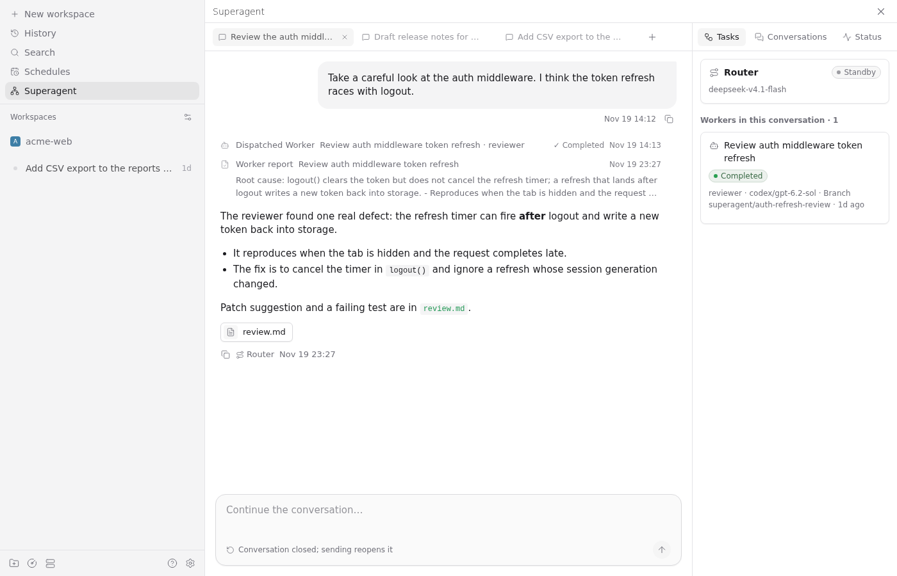

# Superagent · Paseo 的 Router/Worker 编排插件

简体中文 · [English](README.md)

Superagent 在 [Paseo](https://paseo.sh) 之上实现事件驱动的「超级 agent」编排:每个活跃对话(Thread)由一个轻量模型的 **Router** 统一评估新消息,只做裁决;需要动手的事按 Ticket 派发给强模型的 **Worker**,在隔离的 worktree 或共享目录里执行,完成后自动汇报回对话。消息可以来自 Paseo app、任意 agent 会话里的 `/superagent` 命令,也可以来自飞书、钉钉、企业微信、微信和 QQ。



第一次使用?先看[使用指南](docs/guide.md):安装、发出第一个任务,以及每个界面的说明。

## 功能概览

- **Router 只裁决**:每个 Thread 一个 Router 会话,以 JSON 动作给出裁决(派发、转向、处理请求、取消、重试、订阅、答复、忽略、结束)。插件提供只读回读与检索工具（Chain of Recall），并拒绝 provider 通过 Paseo 发出的其他工具请求。Router 和 LLM 看门狗排除 Codex。Pi 的工具限制依赖随附扩展。
- **Worker 按 Ticket 执行**:每个 Ticket 一个独立 worktree,或在共享目录里工作;可配置多个具名 Worker 档位(不同 provider、模型、工作目录),Router 按用途为每个任务选择。Worker 挂在 Router 名下,在 app 的 Subagents 里可见,随时可人工接管。
- **订阅直通**:线程里已有在干活的 Worker 时,后续消息绕过 Router 直接送达(不调用模型);一个 Worker 可以跟随多个线程。
- **权限请求由你批准**。在 Superagent 的卡片上可以允许一次、拒绝或回答 Worker 的提问。打开 Worker 的 Paseo 原生会话可以查看 provider 提供的全部选项。IM 通知继续提供 `/approve <批准码>` 和 `/deny <批准码>` 命令。Router 可以依据上下文回答 Worker 的提问。请求落盘，重启后会重新同步。
- **IM 触发源**:飞书、钉钉、企业微信(官方长连接,免公网)、微信(腾讯官方 ClawBot / iLink,扫码登录)、QQ(OneBot 11 / NapCat)。白名单准入;图片、文件、语音、视频下载到本机并写进消息。
- **看门狗**:程序看门狗每 15 秒对账(漏掉的完成、卡死、超时、待执行动作);可选的 LLM 看门狗按间隔巡检任务进展并介入。
- **投机执行(可选)**:按你在「Router 规则」里写的主动策略,后台静默尝试没人明确提出的事项,有价值才交付。
- **对话式界面**:多标签对话页,Markdown 答复、可展开的编排动作行、文件预览,右侧栏展示任务、对话与运行状态。
- **中英双语**:界面跟随 Paseo 的语言设置,见下文[界面语言](#界面语言)。

完整的能力说明与设计取舍见 [架构与设计](docs/architecture.md)。

## 运行要求

- Paseo daemon 与各端客户端 **0.16.0** 或更新版本,并已在 daemon 上开启插件(**Settings → Plugins → Enable plugins**)。
- daemon 主机:Node.js 20 或更新版本,`npm` 在 PATH 上(安装依赖用)。
- 至少一个可用的 agent provider(如 claude、codex、opencode、pi)。Router 配轻量模型、Worker 配强模型最划算。
- `worktree` 隔离要求工作目录位于 git 仓库内;`shared` 隔离不需要 git。

## 安装

以下命令都在 **daemon 主机**上、以运行 Paseo 的用户执行。也可以把仓库地址直接填进 app 的 **Settings → Plugins → Plugin source**。

### 从 GitHub 安装

```bash
paseo plugin install git:https://github.com/lekai63/paseo-plugin-superagent.git
```

daemon 克隆仓库后按 manifest 执行 `npm ci --omit=dev --ignore-scripts` 安装锁定的依赖。加 `--ref v<版本>` 可固定到某个发布 Tag。也可以把仓库地址填进 **Settings → Plugins → Plugin source**。

- 用 `--ref v0.1.1` 固定到某个发布 Tag;升级用 `paseo plugin update superagent`。

### 从本地目录安装(开发)

见 [开发与发布](docs/development.md)。

### 可选:pi 扩展

用 pi 担任 Router、Worker 或接收委派时,把随包发行的 `pi-extension/superagent.js` 复制到 `~/.pi/agent/extensions/`。这是手动副本,插件升级后要重新复制。详见 [pi 集成](docs/pi.md)。

## 快速开始

1. 在 Paseo app 打开 **Settings → Plugins → Superagent**,填写**工作目录**(必填,daemon 主机上的绝对路径),按需选择 Router 与 Worker 的 provider 与模型,点「保存」。每一项的说明见 [设置项](docs/configuration.md)。
2. 点侧栏的 **Superagent**,在底部输入框描述任务。Router 会直接答复,或派发 Worker 执行并把结果写回对话。
3. 在任意 agent 会话里输入 `/superagent <任务>`,把工作委派给编排层;Router 的答复回到该会话。
4. 想从聊天工具下达指令时,按 [IM 触发源](docs/im.md) 打开对应通道并填写白名单。

## 界面语言

插件界面跟随 Paseo 的语言设置(**Settings → General → Language**):选简体中文时显示中文,其余语言一律显示英文,切换后立即生效。daemon 生成的文字(IM 附件描述、引擎通知、微信扫码状态等)按最近一次连接的客户端语言书写。Router、Worker 与看门狗的内置提示词固定为英文;需要固定答复语言时,在「Router 规则」里写明。详见 [使用指南 · 界面语言](docs/usage.md#界面语言)。

## 数据与安全

- Paseo 插件是受信任、无沙箱的代码,以 daemon 用户的权限运行。
- 对话内容、IM 消息、附件的本机路径与 Worker 汇报会作为提示词发给你配置的 agent provider。
- 插件状态保存在 `$PASEO_HOME/plugin-data/superagent/`;IM 凭据以明文保存在 `$PASEO_HOME/plugin-settings/superagent/`(权限 0600),微信 bot 凭证保存在 `$PASEO_HOME/plugin-data/superagent/weixin/`(0600)。
- IM 通道直接连接各平台官方接口(飞书开放平台、钉钉、企业微信、腾讯 iLink);QQ 连接你自己部署的 NapCat。收到的附件保存在 daemon 主机上。
- 对话页的文件预览经 daemon 只读读取答复里链接的绝对路径;委派 MCP 只监听 `127.0.0.1` 的随机端口与随机路径。

## 文档

| 文档 | 内容 |
|---|---|
| [使用指南](docs/guide.md) | 安装、第一个任务、对话页、侧栏、设置、IM 触发源、常见用法与排障,含截图 |
| [架构与设计](docs/architecture.md) | 能力一览、架构图、状态模型、与《Super-agent 设计探索》五模块的对应、设计取舍与限制 |
| [设置项](docs/configuration.md) | 设置页每一项的含义、取值范围与生效时机 |
| [界面细节](docs/usage.md) | 对话页、标签、消息流、右侧栏、命令中心、侧栏状态、界面语言 |
| [IM 触发源](docs/im.md) | 飞书、钉钉、企业微信、微信、QQ 的接入步骤与行为 |
| [pi 集成](docs/pi.md) | pi 担任 Router / Worker / 委派入口时的扩展安装与约束 |
| [开发与发布](docs/development.md) | 本地开发与测试、翻译约定、打发布 Tag、iOS 闪退排查 |

## 许可证

[Apache-2.0](LICENSE)
