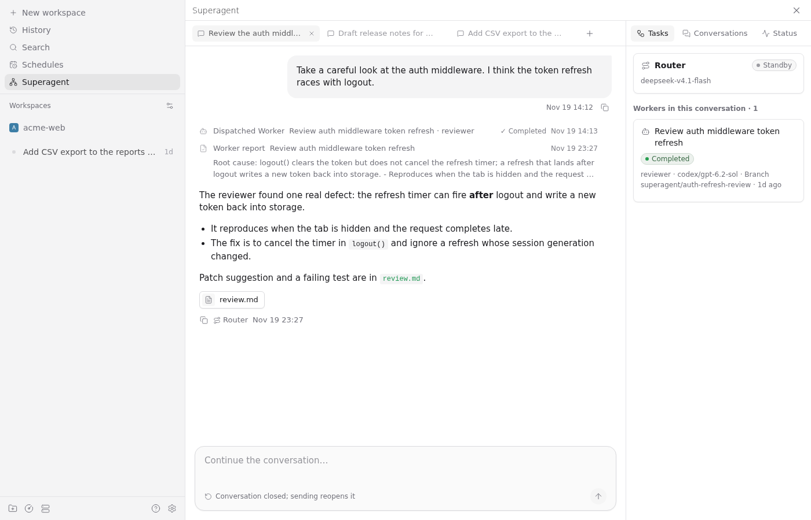

# Superagent · Router/Worker orchestration for Paseo

[简体中文](README-CN.md) · English

Superagent adds event-driven "super-agent" orchestration on top of [Paseo](https://paseo.sh). Each active conversation (thread) gets a **Router** running on a lightweight model that evaluates every new message and only makes decisions. Work that needs doing is dispatched as a ticket to a **Worker** on a stronger model, which runs in an isolated worktree or a shared directory and reports back to the conversation when it finishes. Messages can come from the Paseo app, from the `/superagent` command in any agent session, or from Feishu, DingTalk, WeCom, WeChat and QQ.



New here? Start with the [usage guide](docs/guide-EN.md) for install, a first task, and what every screen shows.

## Features

- **The Router only decides.** It calls an independent inference API with the current triggers, thread memory, and access to read-only recall tools. The plugin validates and applies the JSON verdict.
- **Workers execute tickets.** Each ticket gets a Paseo Worker in an isolated worktree or shared directory. Named profiles can select the model, purpose, and directory. Open a Worker from the Superagent Tasks sidebar.
- **Direct delivery for subscriptions.** While a Worker is working in a thread, follow-up messages skip the Router and go straight to it (no model call). One Worker can follow several threads.
- **You approve permission requests.** Allow once, deny, or answer a Worker question from its card in Superagent. Open the Worker's own Paseo session to review all provider choices. IM notices still include a short `/approve <code>` or `/deny <code>` command. The Router can answer Worker questions from context. Requests are persisted and reconciled after a restart.
- **IM triggers.** Feishu, DingTalk and WeCom (official long-lived connections, no public endpoint needed), WeChat (Tencent's official ClawBot / iLink, QR-code login) and QQ (OneBot 11 / NapCat). Allowlists gate who can trigger; images, files, voice and video are downloaded to the daemon host and referenced in the message.
- **Watchdog.** A programmatic watchdog reconciles every 15 seconds (missed completions, stuck launches, timeouts, pending actions). An optional LLM watchdog patrols task progress on an interval and intervenes.
- **Speculative execution (optional).** Following the proactive policy you write in the Router rules, the Router can quietly try work nobody explicitly asked for and only deliver results worth keeping.
- **Chat-style UI.** Tabbed conversations, Markdown replies, expandable orchestration rows, file previews, and a sidebar with tasks, conversations and runtime status.
- **English and Simplified Chinese.** The UI follows Paseo's language setting; see [Interface language](#interface-language).

For the full feature description and design trade-offs, see [Architecture and design](docs/architecture-EN.md).

## Requirements

- Paseo daemon and all clients **0.16.0** or later, with plugins enabled on the daemon (**Settings → Plugins → Enable plugins**).
- Daemon host: Node.js 20 or later with `npm` on the `PATH` (used to install dependencies).
- A Chat Completions inference API with function calling. Executing tasks also requires a Paseo Worker provider.
- `worktree` isolation requires the working directory to be inside a git repository; `shared` isolation does not need git.

## Installation

Run these commands on the **daemon host**, as the user that runs Paseo. You can also paste the repository URL into **Settings → Plugins → Plugin source** in the app.

### From GitHub

```bash
paseo plugin install git:https://github.com/lekai63/paseo-plugin-superagent.git
```

The daemon clones the repository and installs the locked dependencies with `npm ci --omit=dev --ignore-scripts`, as declared in the manifest. Add `--ref v<version>` to pin a release tag. You can also paste the URL into **Settings → Plugins → Plugin source**.

- Pin a release with `--ref v0.2.0`; upgrade with `paseo plugin update superagent`.

### From a local directory (development)

See [Development and releases](docs/development-EN.md).

### Pi as a Worker provider

Pi Workers and pi sessions with delegation injection use the same standard MCP injection as other providers; the tools are exposed through pi's codemode channel. No extension is needed. [Pi integration](docs/pi-EN.md)

## Quick start

1. In **Settings → Plugins → Superagent → Model**, enter the inference API base URL (for example, `https://inference.example/v1`) and Router model ID. Enter an inference API key on the same tab if required. Use HTTPS for remote endpoints. Set a working directory under **Basics** to dispatch Workers. [Settings](docs/configuration-EN.md)
2. Click **Superagent** in the sidebar and describe a task in the composer. The Router either replies directly or dispatches a Worker and writes the result back into the conversation.
3. In any agent session, type `/superagent <task>` to delegate work to the orchestrator; the Router's reply comes back to that session.
4. To take instructions from a chat app, enable the channel and fill in its allowlist as described in [IM triggers](docs/im-EN.md).

## Interface language

The plugin UI follows Paseo's language setting (**Settings → General → Language**): Simplified Chinese shows Chinese, every other language shows English, and switching takes effect immediately. Text generated by the daemon (attachment descriptions in IM messages, engine notices, WeChat login status and so on) uses the language of the most recently connected client. The built-in Router, Worker and watchdog prompts are always English; to fix the reply language, say so in the Router rules. See [Usage · Interface language](docs/usage-EN.md#interface-language).

## Data and security

- Paseo plugins are trusted, unsandboxed code that runs with the daemon user's permissions.
- Conversation content, IM messages, local paths of downloaded attachments and Worker reports are sent as prompts to the agent providers you configure.
- Plugin state lives in `$PASEO_HOME/plugin-data/superagent/`. IM credentials are stored in plain text in `$PASEO_HOME/plugin-settings/superagent/` (mode 0600), and the WeChat bot credentials in `$PASEO_HOME/plugin-data/superagent/weixin/` (0600).
- IM channels connect directly to each platform's official API (Feishu Open Platform, DingTalk, WeCom, Tencent iLink); QQ connects to the NapCat instance you run. Received attachments are stored on the daemon host.
- File previews in the chat page read absolute paths linked from replies, read-only, through the daemon. The delegation MCP server listens only on `127.0.0.1`, on a random port and secret path.

## Documentation

| Document | Contents |
|---|---|
| [Usage guide](docs/guide-EN.md) | Install, first task, chat page, sidebar, settings, IM triggers, recipes and troubleshooting, with screenshots |
| [Architecture and design](docs/architecture-EN.md) | Feature overview, architecture diagram, state model, mapping to the five modules of the "Super-agent design exploration" article, trade-offs and limitations |
| [Settings](docs/configuration-EN.md) | What each setting means, its range, and when changes take effect |
| [Usage](docs/usage-EN.md) | Chat page, tabs, message stream, sidebar, Command Center, sidebar status, interface language |
| [IM triggers](docs/im-EN.md) | Setup and behavior for Feishu, DingTalk, WeCom, WeChat and QQ |
| [Pi integration](docs/pi-EN.md) | Pi Workers and delegation without any extension: standard MCP injection, codemode tool exposure, and Worker modes |
| [Development and releases](docs/development-EN.md) | Local development and tests, translation conventions, tagging a release, the iOS crash investigation |

## License

[Apache-2.0](LICENSE)
