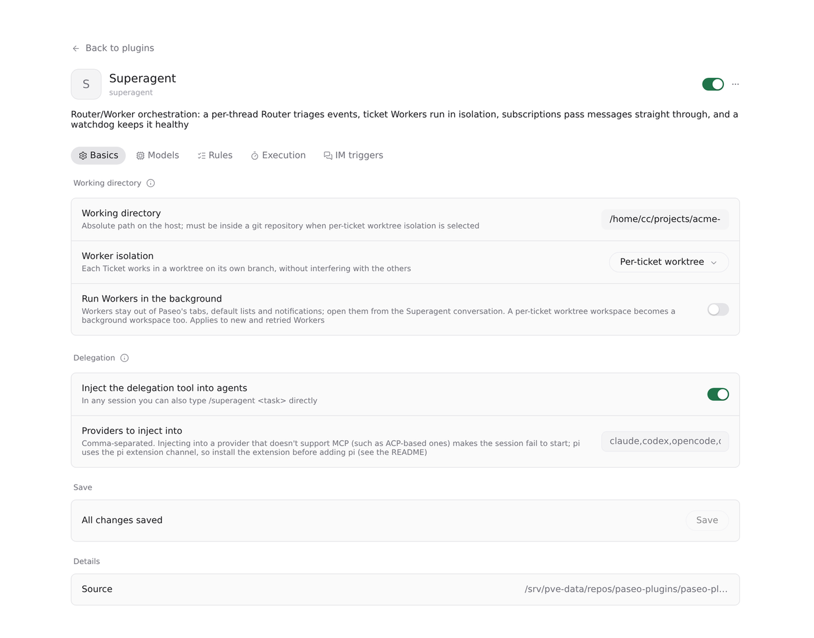
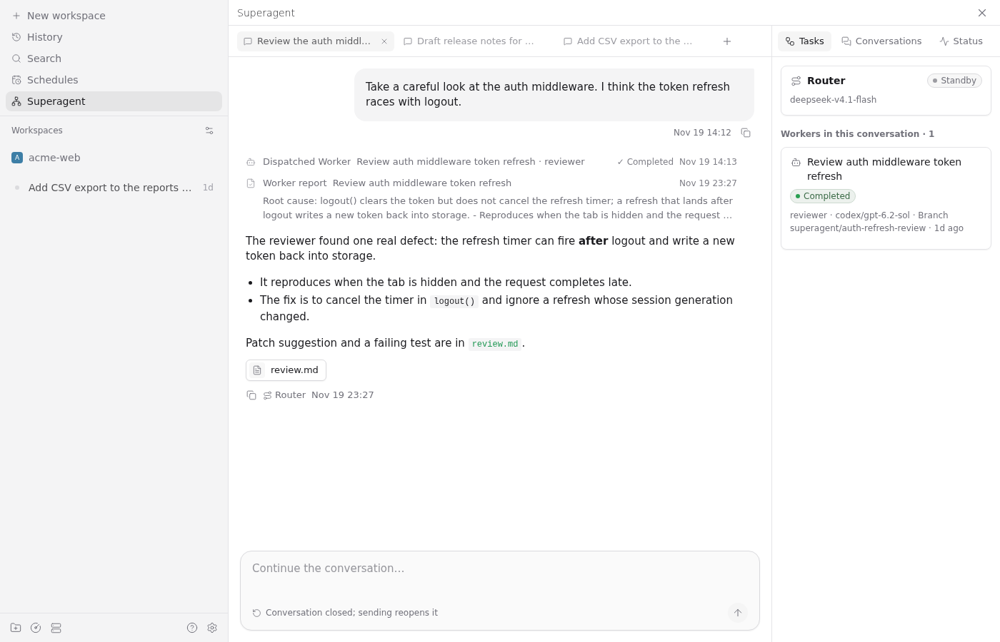
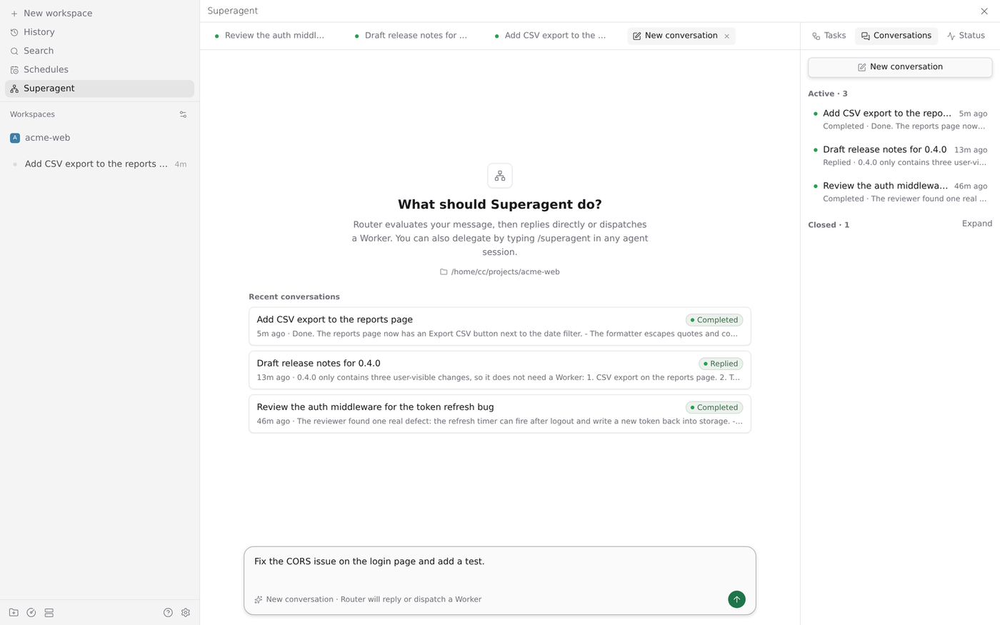
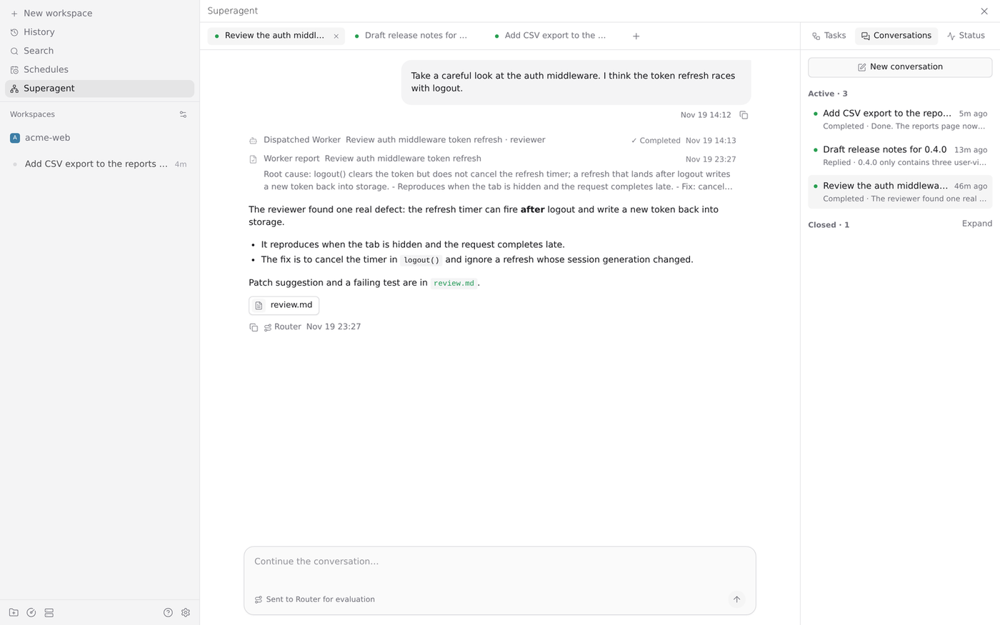
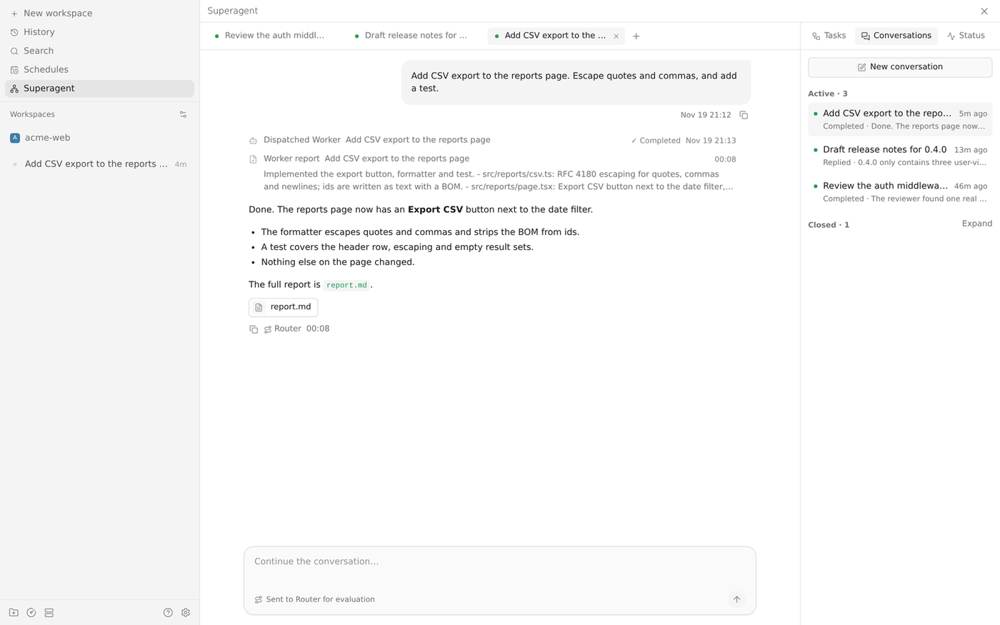
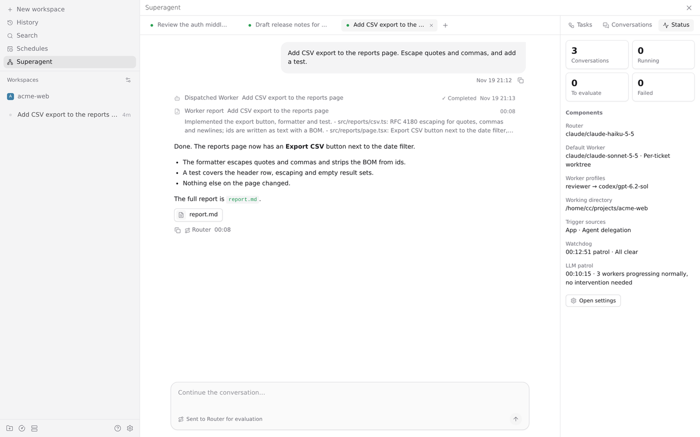
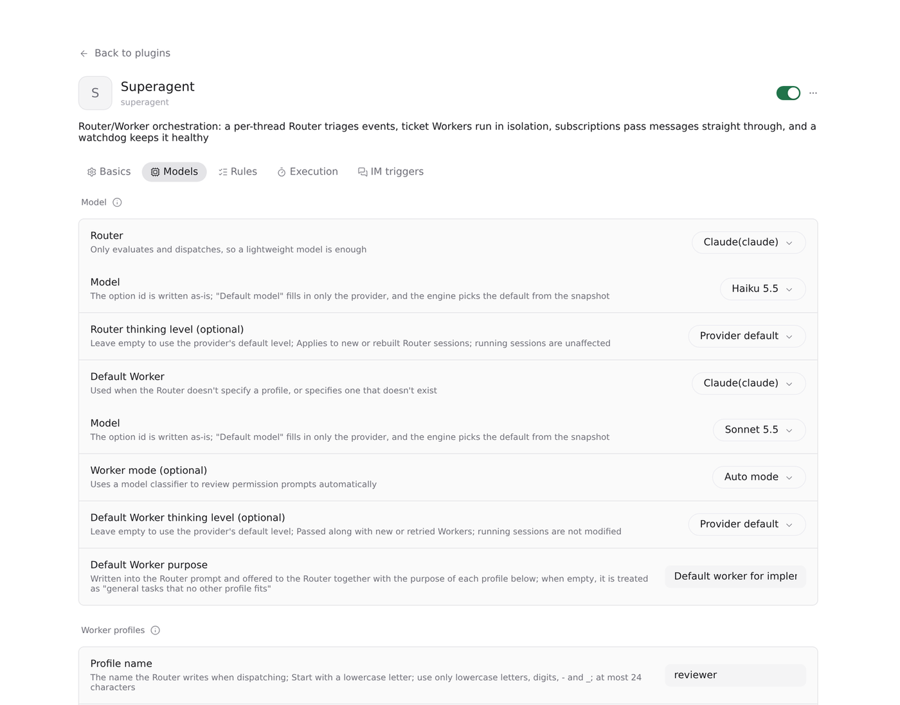
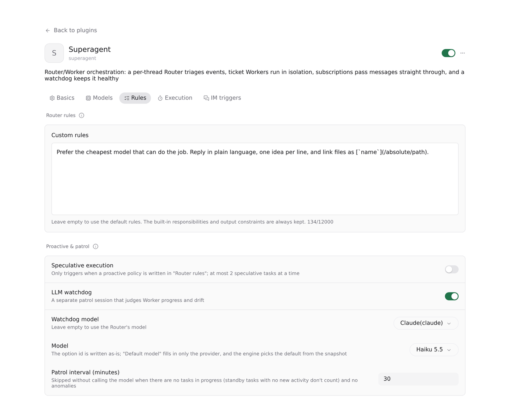
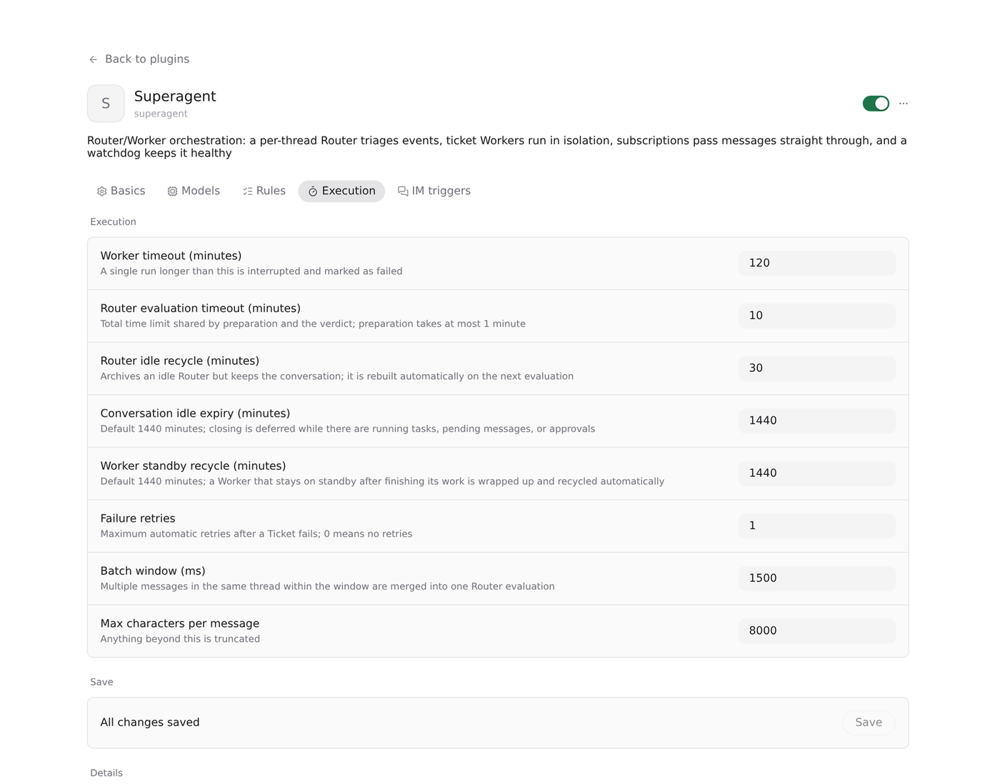
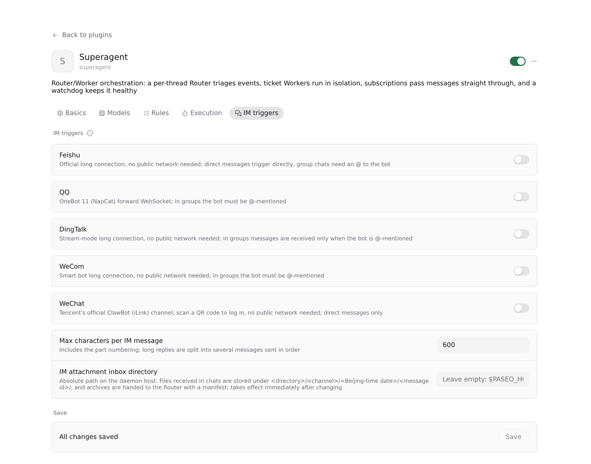

# Usage guide

[简体中文](guide.md) · English · [← Back to README](../README.md)

This guide walks through Superagent the way you actually use it: install it, point it at a repository, send a first task, then read what comes back. Screenshots show a sample project (`acme-web`) with made-up conversations.

- [Before you start](#before-you-start)
- [Install](#install)
- [First run](#first-run)
- [The chat page](#the-chat-page)
- [Reading a conversation](#reading-a-conversation)
- [Tasks, conversations and status](#tasks-conversations-and-status)
- [Delegating from an agent session](#delegating-from-an-agent-session)
- [Settings](#settings)
- [IM triggers](#im-triggers)
- [Everyday recipes](#everyday-recipes)
- [Troubleshooting](#troubleshooting)

## Before you start

Superagent is a plugin for [Paseo](https://paseo.sh). It runs inside a Paseo daemon and adds a second agent layer on top: a **Router** that only decides, and **Worker** agents that do the work.

You need:

- Paseo **0.16.0** or later on the daemon and on every client you use, with plugins enabled (**Settings → Plugins → Enable plugins**).
- On the daemon host: Node.js 20 or later and `npm` on the `PATH`.
- At least one working agent provider (claude, codex, opencode, pi, or another the daemon reports as available).
- A working directory that Workers may edit. With per-ticket worktree isolation it must be inside a git repository; shared-directory isolation does not need git.

You do not need an API key for Superagent itself. It uses the providers you already configured in Paseo.

## Install

Run everything on the **daemon host**, as the user that runs Paseo.

```bash
paseo plugin install git:https://github.com/lekai63/paseo-plugin-superagent.git
```

Or paste the repository URL into **Settings → Plugins → Plugin source** and choose **Install plugin**. Pin a release with `--ref v0.2.0`. Upgrades are `paseo plugin update superagent`.

A local checkout for development is described in the [README](../README.md#installation).

When the install finishes, **Superagent** appears in the Paseo sidebar.

## First run

1. Open **Settings → Plugins → Superagent**. The settings page is split into five tabs: Basics, Models, Rules, Execution and IM triggers.
2. On **Basics**, fill in the **Working directory**: an absolute path on the daemon host. Choose **Worker isolation**: per-ticket worktree (default) or shared directory.
3. On **Model**, enter the inference API base URL and Router model ID. Enter an inference API key on the same tab if required. Use HTTPS for remote endpoints. Leave the default Worker provider empty for automatic selection.
4. Click **Save**.
5. Open **Superagent** in the sidebar and describe a task.



If the working directory is missing or is not a git repository while worktree isolation is selected, both the chat page and the settings page say so, and a dispatch fails with the exact reason instead of a generic error.

## The chat page

The chat page is the main surface. The conversation is on the left; the right sidebar holds everything that is not the conversation.



A first task looks like this:

1. You type in the composer at the bottom. Below it, a live hint says where the message will go: *New conversation*, *Sent to Router for evaluation*, or *Direct to Worker* when an active Worker is subscribed to the thread.
2. The Router reads the message and returns one of several actions. For a task that needs doing it dispatches a **Worker**, shown as a `Dispatched Worker` row.
3. When the Worker finishes, its report comes back as a `Worker report` row (expandable, full original text) and the Router writes a short answer into the conversation.
4. Files the Router links by absolute path appear as file pills under the reply. Click one to preview it: Markdown renders as Markdown, other text opens as a code block, images show directly, and folders can be browsed.

The reply footer shows `Copy · Router · time`. Every user bubble shows its source, delivery status and time.



Sending a message to a closed conversation reopens it. `/superagent <task>` typed in any agent session goes to the same Router (see [Delegating from an agent session](#delegating-from-an-agent-session)).

## Reading a conversation



- **Orchestration rows** (`Dispatched Worker`, `Worker report`, `Steered`, `Canceled`, `Re-evaluated`) are compact and expandable. A dispatch row follows the Ticket's live state and can open the Worker session directly.
- **Status dots** on the tabs mean: spinning halo while the Router is evaluating or a Worker is running, green when answered or complete, red on error.
- **Running indicator.** While something is running, a line at the bottom of the stream shows elapsed time.
- **Scroll.** The stream follows new messages while you are at the bottom and does not interrupt you while you scroll up.

## Approving Worker requests

When a Worker asks to run a tool, leave plan mode or change mode, it pauses and Superagent posts the request to the conversation (and to the IM chat or agent session the task came from). The message quotes the request and ends with a six-character code:

```text
Send /approve 3fa9c1 to allow it once, or /deny 3fa9c1 [reason] to refuse.
```

- Reply `/approve <code>` to allow that one request once, or `/deny <code> not on main` to refuse it with a reason. You can also open the Worker session in Paseo and answer there.
- Only you can approve. The Router cannot approve a request, even if you tell it "yes" in plain words; it will point you to the command instead. It can still answer a Worker's question from the conversation, or ask you.
- In IM, the command must come from an allowlisted sender in the chat where the request was posted, and in a group it must address the bot. Commands sent through the `superagent_dispatch` tool are treated as ordinary messages and approve nothing.
- `/approve` without a code lists the requests waiting for you.

## Tasks, conversations and status

The right sidebar has three tabs.

**Tasks** shows the Router's state and all Workers of the current conversation, with permission waits and session anomalies sorted first.



**Conversations** lists open conversations and, collapsed by default, closed ones. Hover a conversation row for an archive button (touch: select the row first). Archiving closes the conversation and closes its tab.

**Status** shows overview numbers, the configured components, watchdog patrols, and — when a reply did not reach an IM chat — **Undelivered IM replies** with a resend action.



On wide screens the sidebar docks on the right; on narrow screens and phones it opens as an overlay from a title bar button.

## Delegating from an agent session

In any Paseo agent session, type:

```
/superagent Fix the CORS issue on the login page and add a test
```

The task goes to the orchestrator, and the Router's answer comes back into that session. If the **Inject the delegation tool into agents** setting is on (the default), the agent can also call the `superagent_dispatch` tool by itself.

The Router's reply returns to the session that delegated, so you can keep working in the same agent.

## Settings

The five tabs share one draft: switch tabs freely, then **Save** once. Invalid fields are highlighted on their own row.

**Basics** — working directory, Worker isolation, background Workers, delegation injection.

**Model** — inference API, Router model, default Worker provider and mode, and named Worker profiles.



A **Worker profile** is a named alternative Worker (provider/model/purpose, optional dedicated working directory). The Router picks a profile per task by its purpose text, so trigger text can never steer a Worker to an arbitrary provider. With no profiles configured, behavior is exactly one default Worker.

**Rules** — custom Router instructions, plus speculative execution and the LLM watchdog.



Custom rules are injected on every evaluation. Use them for reply language, dispatch preferences and report format, for example “Always reply in Simplified Chinese” or “Link files as `[name](/absolute/path)`”. They supplement the built-in orchestration constraints; the Router still only decides and still outputs JSON actions.

**Execution** — timeouts and limits: Worker runtime, Router evaluation and idle, conversation expiry, Worker standby, failure retries, batch window, and max characters per message.



**IM triggers** — the five chat channels, max characters per IM message, and the attachment inbox directory. See [IM triggers](#im-triggers).



Full per-field documentation is in [Settings](configuration-EN.md).

## IM triggers

Superagent can take instructions from Feishu, DingTalk, WeCom, WeChat and QQ, and send the Router's reply back to the same chat. Every channel is off by default.

Each channel needs its platform bot credentials **and** an allowlist of senders or chats. A channel whose allowlist is empty does not start, so strangers cannot trigger it. Saving hot-reloads the channel; no daemon restart is needed.

Highlights:

- **Feishu, DingTalk, WeCom** use official long-lived connections, so no public endpoint or tunnel is needed.
- **WeChat** uses Tencent's official ClawBot / iLink channel and logs in by scanning a QR code shown on the settings page. Direct messages only.
- **QQ** uses OneBot 11 through NapCat; you run the NapCat instance.
- **Attachments** (images, files, voice, video) are downloaded to the daemon host and referenced in the message by absolute path. Archives are listed but not extracted.

Per-platform setup steps are in [IM triggers](im-EN.md).

## Everyday recipes

**Fix a bug with tests.** Send: “The CSV export drops non-ASCII names. Fix it and add a regression test.” The Router dispatches a Worker, the Worker edits a worktree and runs tests, the Router reports what changed.

**Get a review before merging.** Add a `reviewer` profile pointing at a stronger model with the purpose “code review and root-cause analysis”. Then send: “Review the auth middleware for the token refresh race.” The Router picks the reviewer profile from the purpose text.

**Run parallel work.** Open several conversations; each gets its own Router and its own Workers. Tabs sit side by side and the sidebar shows every running Worker.

**Ask a question instead of doing work.** “What should go into the 0.4.0 release notes?” The Router answers directly without dispatching a Worker.

**Keep answering in one Worker.** While a Worker is subscribed to a conversation, follow-up messages go straight to it with no model call. The composer hint reads *Direct to Worker*.

**Let it watch itself.** Enable the LLM watchdog under **Rules**. It calls the inference API to assess progress on an interval. The plugin rechecks ticket state before applying actions and shows the latest result under Status.

## Troubleshooting

**“Working directory unavailable”.** The path does not exist, is not absolute, or (with worktree isolation) is not inside a git repository. Fix it on **Basics** or switch Worker isolation to shared.

**Workers cannot start.** Check that the chosen provider is available and the model id is valid. The settings page validates against the daemon's provider snapshot and reports available ids.

**The Router keeps failing to parse its own output.** Three consecutive parse failures pause automatic evaluation; press **Re-evaluate** under Tasks to resume.

**An IM channel does not start.** Its allowlist is empty. Add at least one sender or chat and save.

**The Router answers in the wrong language.** Add a rule such as “Always reply in Simplified Chinese” on **Rules**. The built-in prompts are always English; the reply language follows the message and your rules.

**A Worker is stuck.** Open its session from the Tasks tab and take over, or cancel and retry the Ticket. The programmatic watchdog also reaps stuck launches and run timeouts automatically.

---

For the design and trade-offs, see [Architecture and design](architecture-EN.md). For how to develop and release the plugin, see [Development and releases](development-EN.md).
