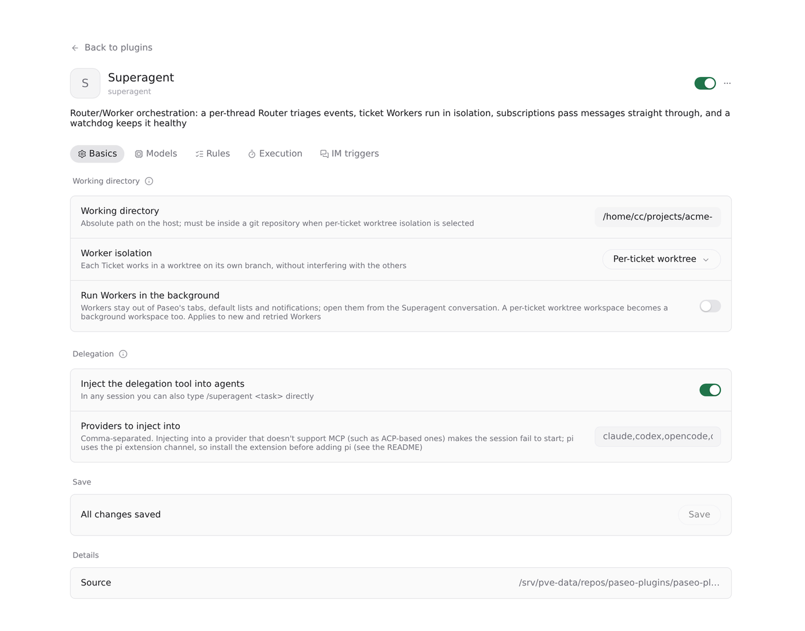
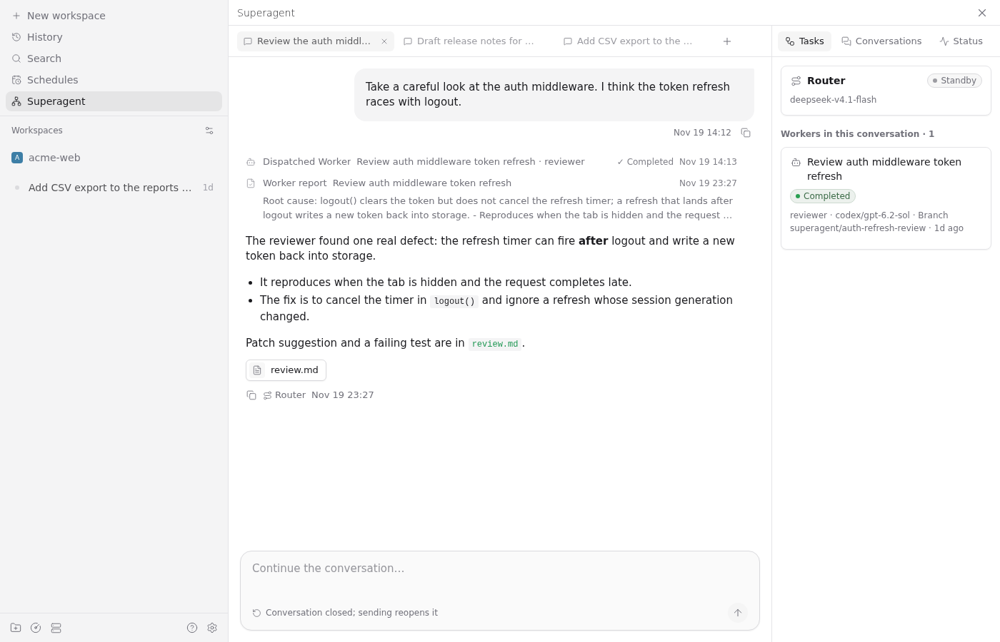
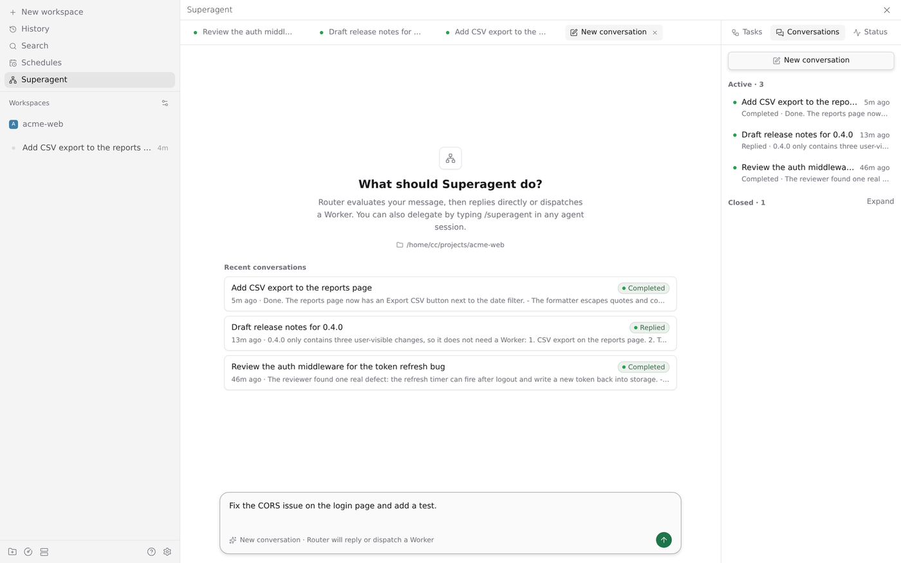
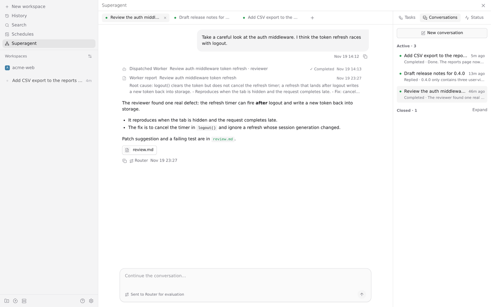
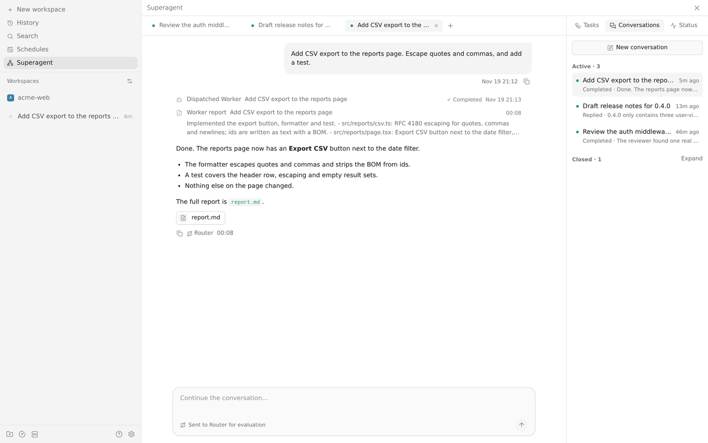
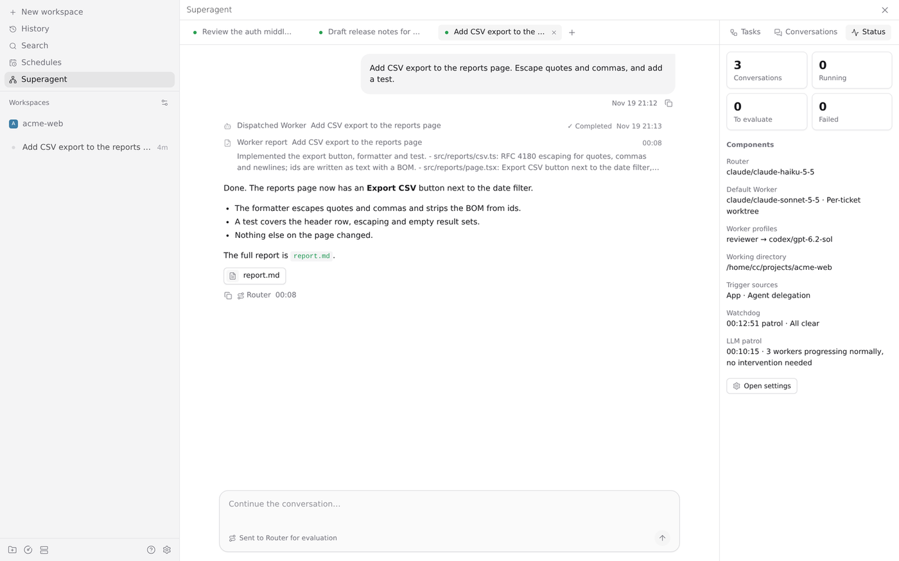
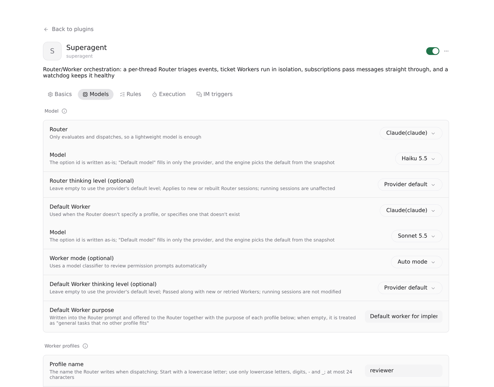
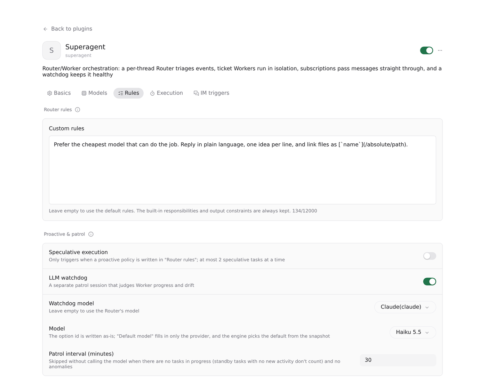
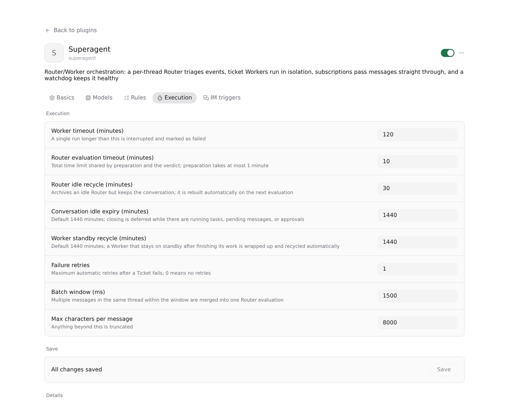
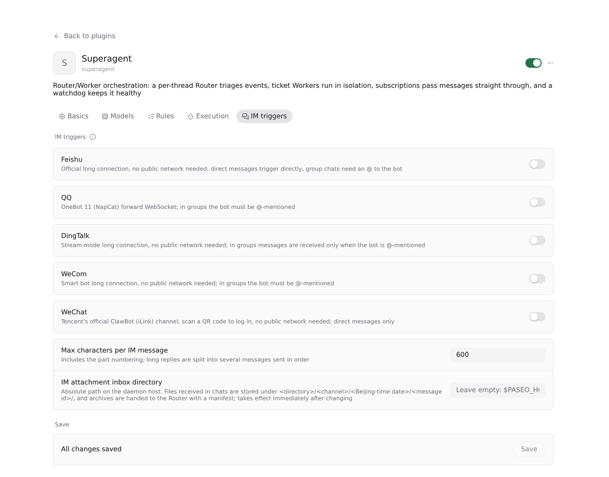

# 使用指南

简体中文 · [English](guide-EN.md) · [← 返回 README](../README-CN.md)

本指南按实际使用顺序介绍 Superagent:安装、指向一个仓库、发出第一个任务,再读回结果。截图来自示例项目 `acme-web`,对话内容均为虚构。

- [开始之前](#开始之前)
- [安装](#安装)
- [首次运行](#首次运行)
- [对话页](#对话页)
- [读懂一段对话](#读懂一段对话)
- [任务、对话与状态](#任务对话与状态)
- [从 agent 会话委派](#从-agent-会话委派)
- [设置](#设置)
- [IM 触发源](#im-触发源)
- [常见用法](#常见用法)
- [排障](#排障)

## 开始之前

Superagent 是 [Paseo](https://paseo.sh) 的插件,运行在 Paseo daemon 里,在原有 agent 之上加一层:只做裁决的 **Router**,以及负责动手的 **Worker**。

需要:

- daemon 与各端客户端都是 Paseo **0.16.0** 或更新版本,并在 daemon 上开启插件(**Settings → Plugins → Enable plugins**)。
- daemon 主机:Node.js 20 或更新版本,`npm` 在 `PATH` 上。
- 至少一个可用的 agent provider(claude、codex、opencode、pi 或 daemon 报告可用的其他 provider)。
- 一个允许 Worker 改动的目录。按 Ticket 独立 worktree 隔离时,它必须位于 git 仓库内;共享目录隔离不需要 git。

Superagent 本身不需要 API key,它使用你在 Paseo 里已经配置好的 provider。

## 安装

以下命令都在 **daemon 主机**上、以运行 Paseo 的用户执行。

```bash
paseo plugin install git:https://github.com/lekai63/paseo-plugin-superagent.git
```

也可以把仓库地址填进 **Settings → Plugins → Plugin source**,选择 **Install plugin**。用 `--ref v0.1.1` 固定到某个发布。升级用 `paseo plugin update superagent`。

以本地目录开发安装见 [README](../README-CN.md#安装)。

安装完成后,Paseo 侧栏出现 **Superagent**。

## 首次运行

1. 打开 **Settings → Plugins → Superagent**。设置页分为五个标签:基础、模型、规则、执行、IM 触发源。
2. 在**基础**里填写**工作目录**:daemon 主机上的绝对路径。选择**Worker 隔离**方式:按 Ticket 独立 worktree(默认)或共享目录。
3. 在**模型**里为 Router 选一个轻量模型,为默认 Worker 选一个更强的模型。任一项留空时,引擎会自动选用第一个可用的 provider。
4. 点击**保存**。
5. 点侧栏的 **Superagent**,描述一个任务。



如果工作目录缺失,或选择了 worktree 隔离但目录不在 git 仓库内,对话页与设置页都会提示,派发失败时也会给出确切原因,而不是笼统报错。

## 对话页

对话页是主界面:左侧是对话,右侧栏放对话之外的一切。



第一个任务的流程:

1. 在底部输入框输入内容。下方的即时提示会说明这条消息将去哪里:*新对话*、*交给 Router 评估*,或已有 Worker 订阅本线程时的*直通 Worker*。
2. Router 读取消息并给出动作。需要动手的任务会派发一个 **Worker**,显示为 `Dispatched Worker` 行。
3. Worker 完成后,汇报以 `Worker report` 行回来(可展开、原文完整),Router 再把一段简短答复写回对话。
4. 答复里以绝对路径链接的文件显示为文件胶囊。点开即可预览:Markdown 按 Markdown 渲染,其他文本进代码块,图片直接显示,目录可逐层进入。

答复页脚是 `复制 · Router · 时间`;每条用户气泡下方显示来源、投递状态与时间。



向已关闭的对话发消息会重新打开它。在任意 agent 会话里输入 `/superagent <任务>` 也会进入同一个 Router(见[从 agent 会话委派](#从-agent-会话委派))。

## 读懂一段对话



- **编排动作行**(`Dispatched Worker`、`Worker report`、`Steered`、`Canceled`、`Re-evaluated`)紧凑且可展开;派发行跟随 Ticket 的实时状态,并可直接打开 Worker 会话。
- **状态点**:标签上旋转的光环表示 Router 正在评估或 Worker 正在运行,绿色表示已答复/完成,红色表示出错。
- **运行指示**:有任务在跑时,消息流底部有一行显示已用时。
- **跟随滚动**:停在底部时自动跟随新消息;向上翻阅时不打断你。

## 批准 Worker 的请求

Worker 请求运行工具、退出计划模式或切换模式时会暂停。Superagent 在对话中显示待处理卡片，可以展开详情、允许一次、拒绝，或打开 Worker 原生会话查看 provider 提供的全部选项。Worker 的提问显示在输入框上方，可以在卡片中选择选项或填写文字，再提交答案。

任务来源的 IM 聊天或 agent 会话仍会收到包含原文摘录和六位批准码的通知。

```text
发送 /approve 3fa9c1 允许这一次,或发送 /deny 3fa9c1 [原因] 拒绝
```

- 回复 `/approve <批准码>` 只放行这一个请求、这一次;回复 `/deny <批准码> 不要动 main` 拒绝并说明原因。也可以在 Paseo 里打开 Worker 会话直接处理。
- 只有你能批准。Router 可以依据对话内容回答 Worker 的提问，或转问你。
- 在 IM 里,命令必须来自白名单发送者、发在请求所在的聊天里,群聊里还要 @ 机器人。经 `superagent_dispatch` 工具发来的命令只当普通消息,不会批准任何请求。
- 只发 `/approve` 不带批准码时,会列出等待你决定的请求。

## 任务、对话与状态

右侧栏有三个标签。

**任务**显示 Router 状态与本对话的全部 Worker,权限等待与会话异常排在最前。



**对话**列出进行中的对话,以及默认收起的已关闭对话。悬停一行出现归档按钮(触屏先选中该行)。归档会关闭对话并关掉它的标签。

**状态**显示概览数字、已配置的组件、看门狗巡检,以及答复未送达 IM 时的**未送达 IM 回复**和重发入口。



宽屏时右侧栏停靠在右侧;窄屏与手机上从标题栏按钮以浮层打开。

## 从 agent 会话委派

在任意 Paseo agent 会话里输入:

```
/superagent 修掉登录页的 CORS 问题，并补一个测试
```

任务交给编排层,Router 的答复回到该会话。若**向 agent 注入委派工具**设置是开启的(默认开启),agent 也可以自己调用 `superagent_dispatch` 工具。

Router 的答复只回投给发起委派的会话,你可以继续在同一个 agent 里工作。

## 设置

五个标签共用一个草稿:随意切换标签,最后**保存**一次。无效字段会在各自行内标红。

**基础** —— 工作目录、Worker 隔离、后台 Worker、委派注入。

**模型** —— Router 的 provider/模型/thinking 档位,默认 Worker 的 provider/模型/模式/thinking 档位、默认 Worker 用途,以及具名 Worker 档位。



**Worker 档位**是具名的备选 Worker(provider/模型/用途,可选专属工作目录)。Router 按用途说明为每个任务选档,因此触发文本无法把 Worker 引向任意 provider。不配置档位时,行为就是一个默认 Worker。

**规则** —— 自定义 Router 指令,以及投机执行与 LLM 看门狗。



自定义规则在每次评估时直接注入。用它固定答复语言、派发偏好与汇报格式,例如「一律用简体中文答复」或「文件用 `[名称](/绝对路径)` 链接」。它补充内置编排约束;Router 仍然只做裁决,仍然输出 JSON 动作。

**执行** —— 各类超时与上限:Worker 单轮运行、Router 评估与空闲、对话过期、Worker 待命、失败重试、批处理窗口、单条消息长度。



**IM 触发源** —— 五个聊天通道、单条 IM 消息长度上限、附件收件目录。见 [IM 触发源](#im-触发源)。



每一字段的完整说明见 [设置项](configuration.md)。

## IM 触发源

Superagent 可以从飞书、钉钉、企业微信、微信和 QQ 接收指令,并把 Router 的答复发回原聊天。所有通道默认关闭。

每个通道都需要对应平台的机器人凭据,**以及**发送者或会话白名单。白名单为空的通道不会启动,防止陌生人触发。保存后即时热重载,无需重启 daemon。

要点:

- **飞书、钉钉、企业微信**使用官方长连接,不需要公网入口或隧道。
- **微信**使用腾讯官方 ClawBot / iLink 通道,扫描设置页上的二维码登录,仅支持私聊。
- **QQ** 通过 NapCat 走 OneBot 11,由你自己运行 NapCat。
- **附件**(图片、文件、语音、视频)下载到 daemon 主机,并以绝对路径写进消息。压缩包只列清单、不解压。

各平台的接入步骤见 [IM 触发源](im.md)。

## 常见用法

**修 bug 并补测试。** 发送:「CSV 导出会丢失非 ASCII 名字,修掉并补一个回归测试。」Router 派发 Worker,Worker 在 worktree 里改代码并跑测试,Router 汇报改了什么。

**合并前先审查。** 添加一个 `reviewer` 档位,指向更强的模型,用途写「代码审查与疑难根因定位」。然后发送:「审查认证中间件的 token 刷新竞争问题。」Router 按用途说明选审查档位。

**并行推进。** 同时开多个对话,每个对话有自己的 Router 和自己的 Worker;标签并排,侧栏能看到所有运行中的 Worker。

**只问不做。** 「0.4.0 的发布说明应该写什么?」Router 直接答复,不派发 Worker。

**让一个 Worker 持续接话。** Worker 订阅了某对话时,后续消息不经模型直接送达它,输入框提示显示*直通 Worker*。

**让它自己盯着。** 在**规则**里打开 LLM 看门狗。每隔一段时间,独立的 `Superagent Watchdog` 会话检查未完成的 Worker,判断是否有实质进展,必要时提醒、打断、取消或重试。你可以打开该会话问它看到了什么。

## 排障

**提示「工作目录不可用」。** 路径不存在、不是绝对路径,或在 worktree 隔离下不在 git 仓库内。到**基础**里修正,或把 Worker 隔离改为共享目录。

**Worker 起不来。** 确认所选 provider 可用、模型 ID 有效。设置页会对照 daemon 的 provider 快照校验,并列出可用 ID。

**Router 反复解析失败。** 连续三次解析失败会暂停自动评估;在「任务」里点**重新评估**恢复。

**IM 通道不启动。** 白名单为空。至少填一个发送者或会话后保存。

**Router 答复语言不对。** 在**规则**里加一条「一律用简体中文答复」。内置提示词固定为英文;答复语言跟随消息内容与你的规则。

**Worker 卡住。** 从「任务」标签打开它的会话接管,或取消并重试该 Ticket。程序看门狗也会自动回收卡住的启动与超时的运行。

---

设计与取舍见 [架构与设计](architecture.md);如何开发与发布见 [开发与发布](development.md)。
